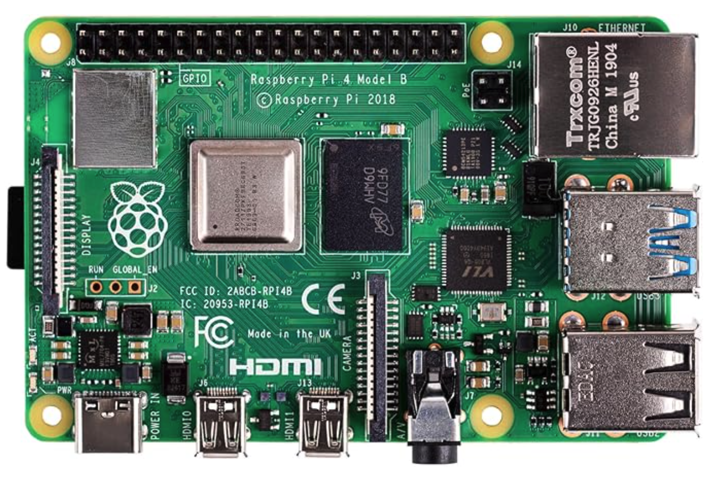
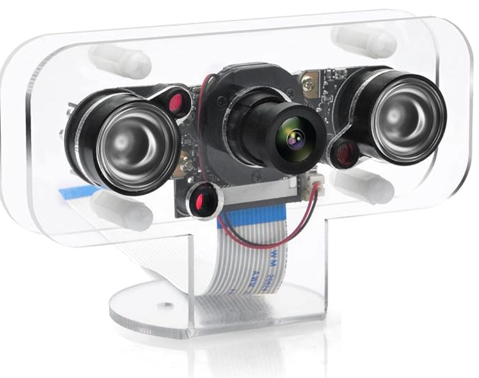

# RaspberryPi-Baby-Monitor-Server

This code was tested on Raspberry Pi 4 Model B, a camera, and a microphone bought from Amazon.

This project is developed with the following technologies:

- **Python**: Version 3.11.2
- **MediaMTX**: H.264 from the Raspberry Pi camera (hardware encode on Pi 4, software encode on Pi 5), plus WebRTC to the browser.
- **FFmpeg**: Muxes USB microphone audio as Opus onto the same live stream.
- **FastAPI**: Serves the phone web app and proxies the WebRTC handshake on port 8000.

Video and crying audio are one low-latency WebRTC stream (the same approach IP cameras use in a browser). Open:

**http://PI-IP:8000** (for example `http://192.168.0.200:8000`)

Tap the page once on iPhone to unmute. The MediaMTX debug player is at **http://PI-IP:8889/baby**.

# Used Hardware

- Raspberry Pi 4 Model B (4GB) : [AMAZON Link](https://amzn.asia/d/4z4v2ZW)



- Camera: OSOYOO IR-CUT Camera for Raspberry Pi : [AMAZON Link](https://www.amazon.co.jp/dp/B08K9348F6?ref=ppx_yo2ov_dt_b_fed_asin_title)



- Microphone: USB Microphone : [AMAZON Link](https://www.amazon.co.jp/dp/B0CD7KPH3K?ref=ppx_yo2ov_dt_b_fed_asin_title)


## Folder structure

```
.
├── bin/mediamtx            // MediaMTX binary (downloaded, not committed)
├── scripts
│   ├── install_mediamtx.sh
│   └── start_baby_monitor.sh
├── static
│   ├── imgs
│   ├── index.html
│   ├── reader.js
│   └── manifest.json
├── main.py
├── mediamtx.yml
├── README.md
├── requirements.txt
└── LICENSE
```

## How to run

clone the repository
```
git clone repository-url
cd RaspberryPi-Baby-Monitor-Server
```

Create a virtual environment and install the dependencies
```
python3 -m venv venv
source venv/bin/activate
pip install -r requirements.txt
```

Install MediaMTX (arm64 binary into `bin/`)
```
scripts/install_mediamtx.sh
```

Start MediaMTX and the web app (no `--reload`)
```
scripts/start_baby_monitor.sh
```

On this Pi the existing `@reboot` crontab still calls `/home/hussain/start_baby_monitor.sh`, which now launches the same script.

You should get uvicorn listening on `http://0.0.0.0:8000`. Open that URL on a phone on the same Wi-Fi, tap once, and you should hear the room with the picture.

If WebRTC connects but stays black, check that UDP port 8189 is not blocked, and that `/health` returns `"stream": true`.
